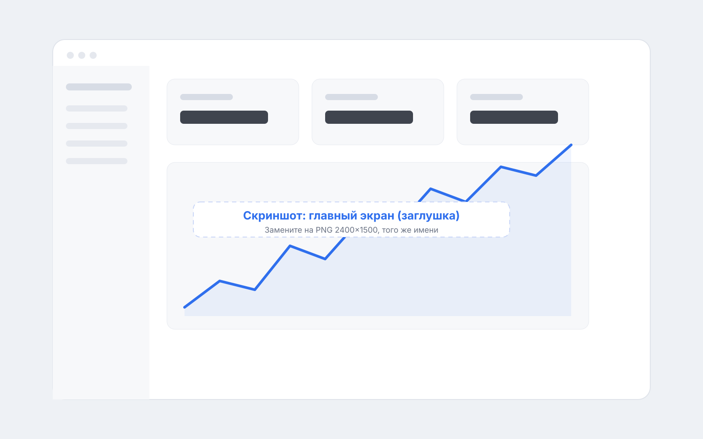

# Your game analytics. One workspace.

Nami is a desktop app for game developers. Collect, explore and understand your game performance — all in one workspace.

**Supported platforms:** [Yandex Games](https://games.yandex.ru/)

 

 

**[Download](https://github.com/TommyNash/nami/releases/latest)** · **[Documentation](README.md)** · **[Releases](https://github.com/TommyNash/nami/releases)**

[Русский](README.md) · **English**

 

  

Nami collects console data for supported platforms with a Chrome extension and stores it in a local SQLite database. Revenue, players, metrics and game comparisons stay on your computer.

The product documentation, installation guide and release notes are in Russian: see [README](README.md).
