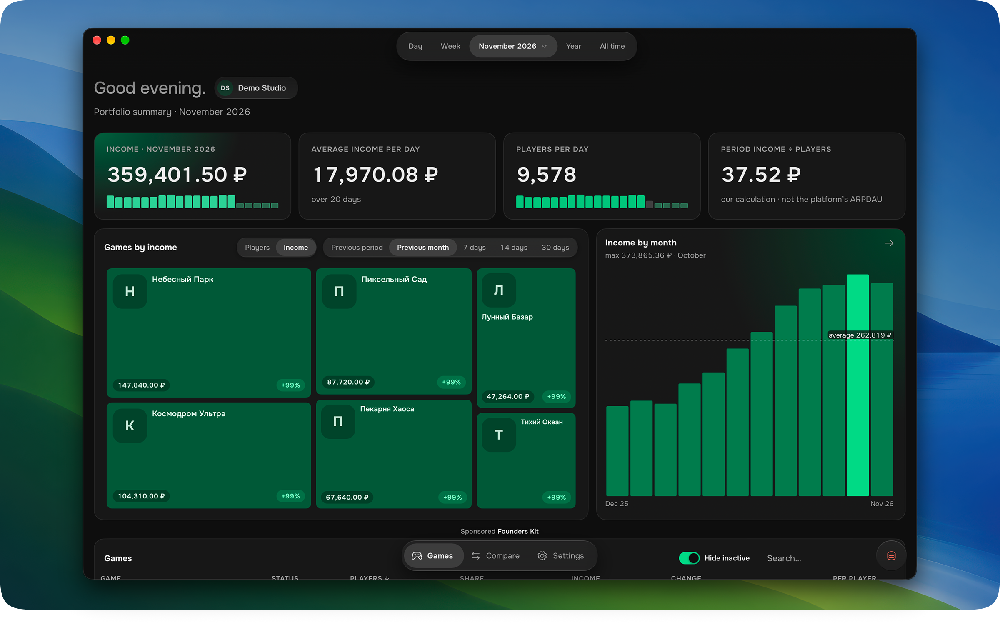
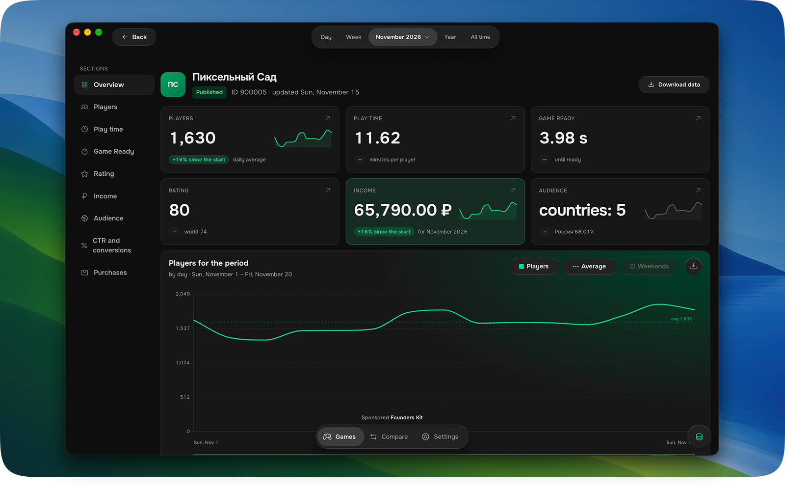
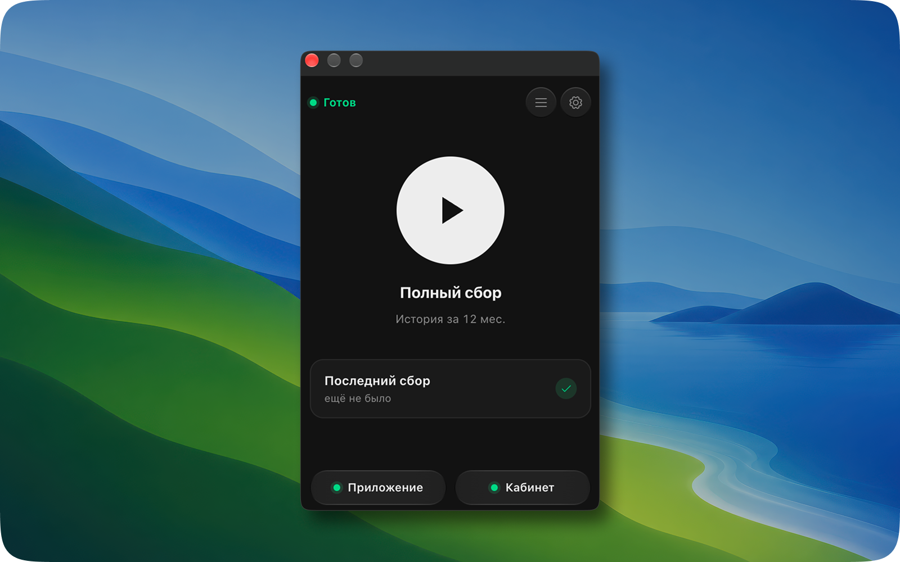
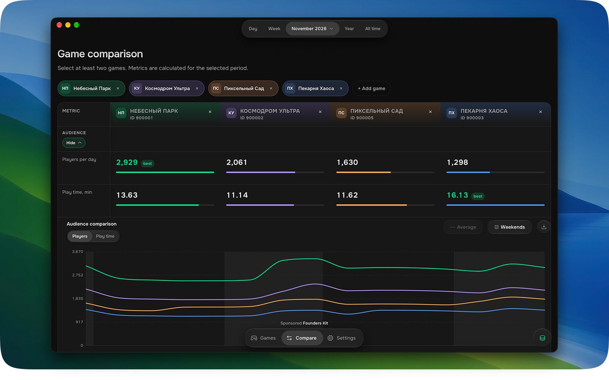
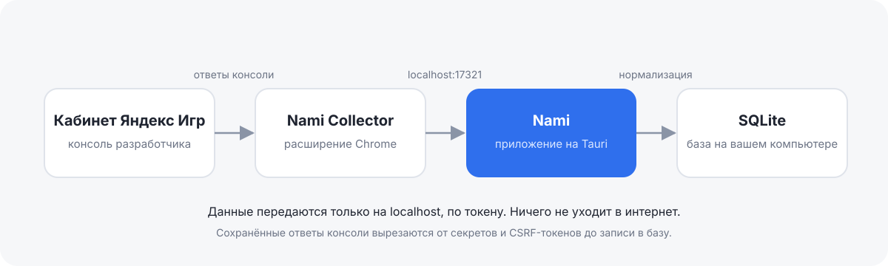
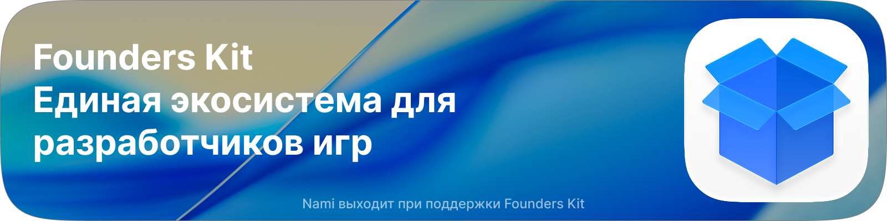

<div align="center">


# Аналитика ваших игр. Одно рабочее пространство.

Nami — настольное приложение для разработчиков игр. Собирайте, изучайте и понимайте показатели игр — всё в одном рабочем пространстве.

**Поддерживаемые платформы:** [Яндекс Игры](https://games.yandex.ru/)

<br />


[](LICENSE)

<br />

**[Скачать](https://github.com/TommyNash/nami/releases/latest)** · **[Документация](#для-разработчиков)** · **[Релизы](https://github.com/TommyNash/nami/releases)**

**Русский** · [English](README.en.md)

</div>

<br />

<p align="center">
  
</p>

<table>
  <tr>
    <td width="50%"></td>
    <td width="50%"></td>
  </tr>
  <tr>
    <td colspan="2" align="center"></td>
  </tr>
</table>

## Возможности

- **Портфель на одном экране.** Доход, игроки и динамика по всем играм — за день, неделю, месяц или год.
- **Таблица игр.** Сортировка и фильтры по всему портфелю, доли и изменения, скрытие неактивных игр.
- **Тепловая карта.** Сравнивайте игры и метрики по дням одним взглядом.
- **Карточка игры.** Метрики, доход, оценки, отзывы и покупки по каждой игре.
- **Сравнение.** Несколько игр рядом за один период.
- **Данные, которым можно верить.** Для каждого дня видно, полные ли данные. Яндекс отдаёт статистику с задержкой, и Nami показывает дату, до которой данные реально есть.
- **Выгрузка.** CSV, Excel, JSON или готовый файл для анализа. Полная резервная копия и восстановление в одном файле `.nami`.

## Как это работает

<p align="center">
  
</p>

1. Откройте консоль платформы (сейчас поддерживаются **Яндекс Игры**) и просмотрите свои игры.
2. **Nami Collector** (расширение Chrome) собирает статистику и передаёт её в **Nami** только на ваш компьютер (`localhost`).
3. Nami очищает данные от секретов, считает метрики и сохраняет их в локальную базу **SQLite**.

Данные остаются у вас. Ничего не уходит в интернет.

## Начало работы

### 1. Скачайте приложение

Откройте [Релизы](https://github.com/TommyNash/nami/releases/latest) и выберите файл:

| Платформа | Файл |
| --- | --- |
| macOS, Apple Silicon | `Nami_*_aarch64.dmg` |
| macOS, Intel | `Nami_*_x64.dmg` |
| Windows 10 / 11, 64-bit | `Nami_*_x64-setup.exe` |
| Расширение Chrome (для всех систем) | `nami-collector-v*.zip` |

Сборки не подписаны Apple и Microsoft, поэтому при первом запуске система может предупредить:

- **macOS:** правый клик по приложению → **Открыть**. Если macOS пишет, что приложение «повреждено», выполните в Терминале:
  ```bash
  xattr -cr "/Applications/Nami.app"
  ```
- **Windows:** SmartScreen → **Подробнее** → **Выполнить в любом случае**.

### 2. Установите расширение Chrome

1. Скачайте архив `nami-collector-v*.zip` из [релиза](https://github.com/TommyNash/nami/releases/latest) и распакуйте его. Или в Nami откройте **Настройки** → **Расширение для Chrome** и нажмите **Скачать** — папка `nami-collector` появится в «Загрузках».
2. Откройте `chrome://extensions` в Chrome, включите **Режим разработчика** и нажмите **Загрузить распакованное**.
3. Выберите папку `nami-collector` (внутри распакованного архива или в «Загрузках»).
4. В попапе расширения нажмите **Подключить к приложению**.
5. Откройте [консоль Яндекс Игр](https://games.yandex.ru/console/) и просмотрите свои игры. Данные автоматически попадут в Nami.

Пока собираются данные, приложение Nami должно быть запущено.

## Системные требования

- **macOS**, Apple Silicon или Intel (`.dmg`)
- **Windows** 10 или 11, 64-bit (`.exe`)
- **Google Chrome** (или другой браузер на базе Chromium) для Nami Collector

## Технологии

- **[Tauri 2](https://tauri.app)** — оболочка приложения, IPC между интерфейсом и бэкендом
- **Rust** — сервер приёма данных, нормализация, аналитика, выгрузка
- **SQLite** (`rusqlite`) — все данные хранятся локально
- **Vanilla JavaScript** — интерфейс без фреймворков
- **Расширение Chrome (Manifest V3)** — Nami Collector

## Для разработчиков

Нужны Node.js, Rust и Tauri CLI.

```bash
npm install
npm start                 # запуск приложения в режиме разработки
npm run pack:extension    # сборка ZIP расширения в dist/
```

Структура проекта:

```
src-tauri/   приложение Tauri: IPC, ingest, normalize, SQLite
crates/      доменные crates: core, storage, analytics
renderer/    интерфейс приложения (ванильный JS)
extension/   Nami Collector (Chrome MV3)
scripts/     сборка, проверки, генерация служебных файлов
docs/        архитектура приложения
```

Безопасность:

- Приём данных только с `localhost`.
- Токен сопряжения выдаётся локально.
- Секреты и CSRF-токены вырезаются перед сохранением.

Подробнее об устройстве: [docs/ARCHITECTURE.md](docs/ARCHITECTURE.md).

## Участие в проекте

Идеи, баг-репорты и pull request приветствуются. Перед началом прочитайте [CONTRIBUTING.md](CONTRIBUTING.md) и [docs/ARCHITECTURE.md](docs/ARCHITECTURE.md).

## Лицензия

Nami распространяется по лицензии [PolyForm Noncommercial 1.0.0](LICENSE). Вы можете использовать, менять и распространять проект в некоммерческих целях.

Коммерческое использование, продажа и платное распространение возможны только с согласия Founders Games. См. [COMMERCIAL.md](COMMERCIAL.md).

<br />

<p align="center">
  <a href="https://kit.founders-universe.com">
    
  </a>
</p>

<p align="center">
  <a href="https://kit.founders-universe.com"><b>Founders Kit</b></a> · <a href="https://kit.founders-universe.com">https://kit.founders-universe.com</a>
</p>
